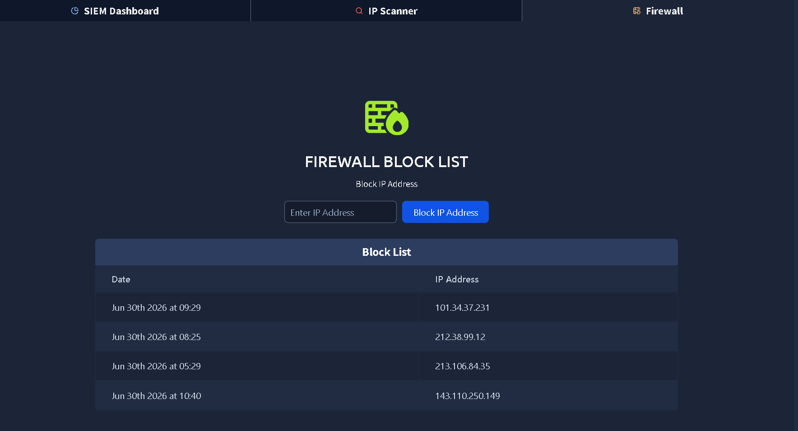
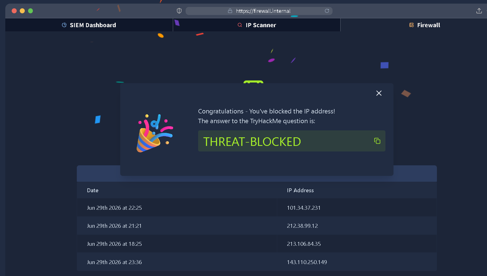

# TryHackMe – Defensive Security Intro

**Platform:** TryHackMe · **Category:** Defensive Security · **Difficulty:** Easy · **Completed:** 2026-06

## Summary

- **Scenario:** A simplified SOC workflow: review SIEM alerts, decide whether the activity is a real threat, contain it, and escalate.
- **Result:** Identified `143.110.250.149` as a malicious source with a successful SSH login, confirmed it with threat intelligence, blocked it, and escalated to the SOC Team Lead.
- **Key takeaway:** Blocking a malicious IP is not the end of an incident. A successful authentication means the investigation has to continue.

---

## Methodology

### 1. Alert review

The investigation began by reviewing alerts generated in the SIEM dashboard.

Among the logged events, IP address **143.110.250.149** immediately stood out because it appeared in multiple SSH-related alerts. The activity included an **unauthorized connection attempt** followed by a **successful SSH authentication** to port 22.

While isolated failed authentication attempts are common, a successful authentication immediately after suspicious activity increases the likelihood of unauthorized access. Based on this sequence, I selected the IP address for further investigation.

*Figure 1: Multiple alerts involving IP address `143.110.250.149`, including a successful SSH authentication event.*

### 2. Threat intelligence validation

To determine whether the activity was malicious or a false positive, I investigated the IP address using the integrated IP Scanner. The lookup classified the address as **Malicious** with a **100% confidence score**.

| Indicator | Value |
|-----------|-------|
| IP Address | 143.110.250.149 |
| Confidence | 100% |
| ISP | China Mobile Communications Corporation |
| Domain | chinamobileltd.thm |
| Country | China |
| City | Zhenjiang, Jiangsu |

The threat intelligence aligned with the SIEM findings. Since both internal telemetry and external reputation data indicated malicious activity, I treated the IP as a confirmed indicator of compromise rather than continuing to monitor it.

*Figure 2: Threat intelligence confirmed the IP address as malicious with a confidence score of 100%.*

### 3. Containment

After validating the indicator, I blocked **143.110.250.149** using the firewall management interface. This stopped further communication from that source while the investigation continued. Blocking an IP alone does not guarantee that an attacker has been removed from the environment, but it reduces the opportunity for additional malicious activity during incident response.

*Figure 3: The malicious IP address added to the firewall block list.*

### 4. Escalation

The incident was escalated to the **SOC Team Lead** after containment. The decision was based on the **successful SSH authentication event**, not simply on the IP's malicious reputation.

Even though the firewall rule prevented future connections, the successful login raised questions that needed further investigation:

- Whether valid credentials had been compromised.
- Whether persistence mechanisms had been established.
- Whether additional hosts had communicated with the attacker.
- Whether any post-authentication activity had occurred before containment.

*Figure 4: Escalating the incident to the SOC Team Lead for continued investigation.*

*Figure 5: Successful completion of the Defensive Security Intro room.*

---

## Findings and Impact

**Finding:** A malicious external IP made an unauthorized connection attempt and then a successful SSH authentication to port 22.
**Related ATT&CK techniques:** T1021.004 (Remote Services: SSH), and T1078 (Valid Accounts) if legitimate credentials were used.

**Impact:** A successful SSH login gives an attacker interactive access to the host. Until the questions listed under Escalation are answered, the possible impact includes compromised credentials, persistence on the host, and movement to other systems. Containing the IP limits further access but does not show that the host is clean.

---

## Detection and Mitigation

**Detection improvements:**

- A correlation rule that raises severity when a failed or unauthorized SSH attempt is followed by a successful login from the same source IP within a short window. The SIEM in this lab showed the events separately, and correlating them is what made the case clear.
- Automatic threat-intelligence enrichment on every external IP involved in an authentication alert, so the reputation check does not depend on an analyst running it by hand.
- An alert for any successful SSH login from an external IP that is not on an expected list.

**Mitigation and hardening:**

- Disable password authentication for SSH and require key-based login.
- Restrict SSH to a VPN or an allowlist of known addresses instead of exposing port 22 to the internet.
- Rate-limit or temporarily ban sources with repeated failed logins.
- For the affected account: reset credentials, review activity after the login time, and check for new users, keys, scheduled tasks and other persistence.

---

## Next Steps

- Build the SSH correlation rule myself in Splunk or an ELK stack instead of only reading a prebuilt dashboard.
- Practice reading raw authentication logs so I can investigate the post-login activity this room only describes.

---

**Tools:** TryHackMe AttackBox, simulated SIEM dashboard, integrated IP Scanner, firewall management interface
**References:** TryHackMe – Defensive Security Intro