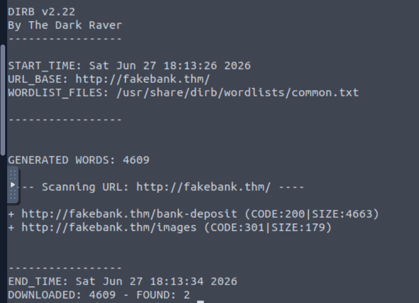
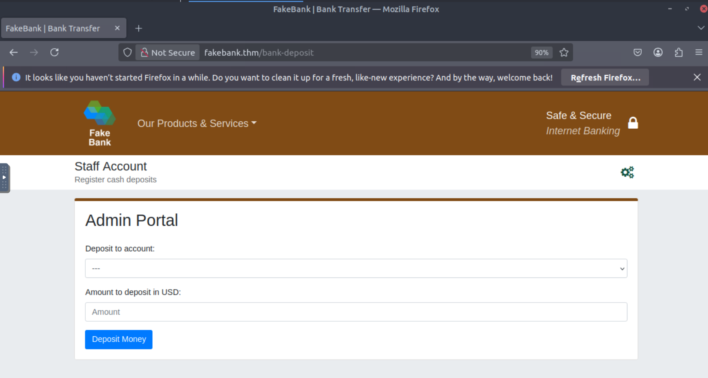
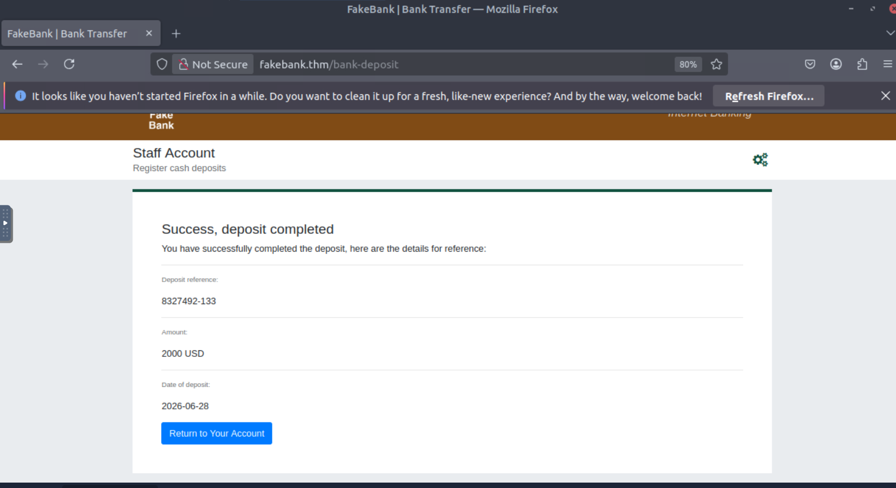
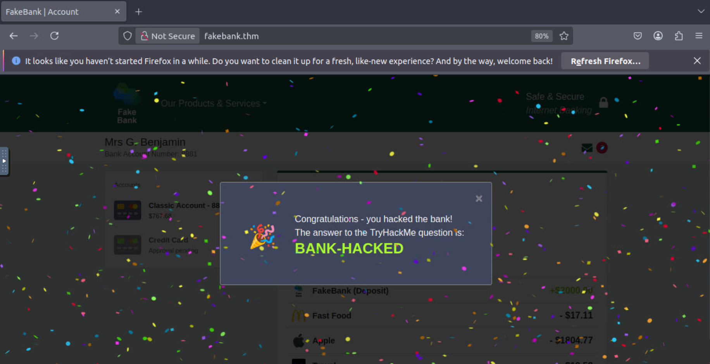

# TryHackMe – Offensive Security Intro

**Platform:** TryHackMe · **Category:** Web Security · **Difficulty:** Easy · **Completed:** 2026-06

## Summary

- **Scenario:** A training banking app (FakeBank) with no obvious way to complete the task from its normal pages.
- **Result:** Found an unlinked `/bank-deposit` endpoint with DIRB and used it to complete the lab objective.
- **Key takeaway:** A hidden URL is not an access control. Sensitive functionality needs server-side authorization.

---

## Methodology

After browsing the available pages, I didn't find any obvious functionality that could be used to complete the task. The next step was to enumerate hidden directories using **DIRB**.

```bash
dirb http://fakebank.thm
```

The scan used the default `common.txt` wordlist and tested **4,609** directory names.

Relevant results:

```text
+ http://fakebank.thm/bank-deposit (CODE:200|SIZE:4663)
+ http://fakebank.thm/images (CODE:301|SIZE:179)
```

`/bank-deposit` was the most interesting result because it returned a normal page (200) for functionality that wasn't available through the application's navigation. `/images` returned a redirect (301) and was not useful.



*Figure 1: DIRB identified the hidden `/bank-deposit` endpoint.*

Opening the page revealed a form with two fields: deposit account number and deposit amount.



*Figure 2: Hidden deposit page.*

For the lab exercise, I submitted account `8881` and amount `2000`. Returning to the account page, I confirmed that the balance had increased, and the application displayed a success message.



*Figure 3: Updated account balance.*



*Figure 4: Successful completion of the lab.*

---

## Findings and Impact

**Vulnerability:** Forced browsing / broken access control
**References:** OWASP Top 10 A01:2021 (Broken Access Control), CWE-425 (Direct Request / Forced Browsing)

The deposit functionality was reachable by requesting its URL directly, even though no page linked to it. In this lab, knowing the URL was enough to use the feature.

**Impact:** In a real application, an endpoint that changes account data and relies on being hard to find would let anyone who discovers it modify balances. Discovery is easy with common wordlists, so obscurity gives very little protection.

---

## Detection and Mitigation

**Detection (what a defender would look for):**

- A burst of requests from one source IP in a short time. This scan tested 4,609 paths, so web server access logs would show thousands of requests in a row.
- A very high share of 404 responses from that IP, with a few 200 or 301 responses for paths that appear in no site navigation.
- Requests for paths with default wordlist names, sometimes with a recognizable scanner user-agent.
- A SIEM or WAF rule that alerts when one IP exceeds a threshold of 404s per minute.

**Mitigation:**

- Enforce authentication and authorization on the server for `/bank-deposit`, so a request is rejected unless the user is allowed to perform that action.
- Don't treat an unlinked URL as protected. Assume every endpoint will be found.
- Rate-limit or block clients that generate large numbers of 404 responses.
- Remove or restrict anything unneeded (test pages, old endpoints) from production.

---

## Next Steps

- Practice the same idea on PortSwigger's access control labs, where the goal is to exploit and then fix broken authorization, not just find a hidden page.
- Learn to read web server access logs so I can see this scan from the defender's side.

---

**Tools:** Kali Linux AttackBox, DIRB v2.22, Mozilla Firefox
**References:** TryHackMe – Offensive Security Intro; DIRB documentation